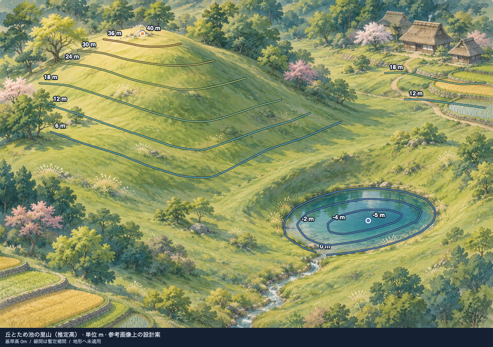
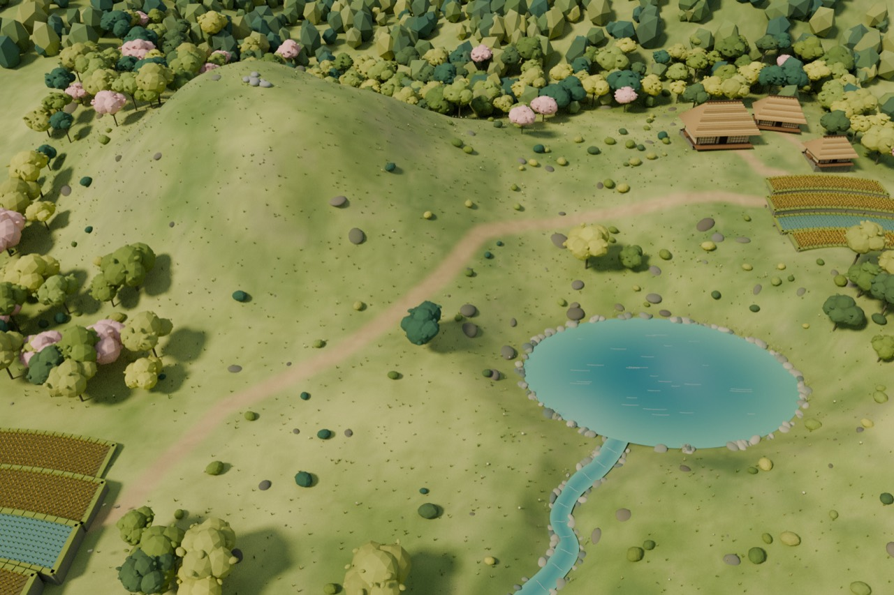

# ContourDesigner

風景イラストの上に等高線と標高点を置き、丘・谷・池の高低差を設計するブラウザーツールです。画像を読めるAIに最初の案を作ってもらい、ブラウザーで線を動かして仕上げられます。

## イラストをAIに渡して等高線を作る

元のイラストを画像対応のAIに添付し、次の依頼文を貼り付けます。ContourDesigner 側のAPIキーやアカウントは不要です。

~~~text
添付した元のイラストを見て、丘・斜面・谷・池を読み取り、地面の等高線と標高点を設計してください。高さはメートル単位の推定値で構いません。
https://github.com/yosimin265/contourdesigner の AI-GUIDE.md に従い、私の画像に合わせた contourdesigner.ai-plan v1 の JSON を terrain.ai-plan.json として返してください。ファイルを添付できない場合は、保存できる完全なJSONを返してください。
コマンドを実行できる場合は同梱の render-contours.cjs で、またはPythonなどで、同じ座標の等高線と高さを元画像に重ねたSVGかPNGも添付してください。
~~~

AIがリポジトリを開けない環境では、元画像と一緒にガイドを添付できます。[AI向けガイド](https://github.com/yosimin265/contourdesigner/blob/main/AI-GUIDE.md)

1. GitHub の **Code → Download ZIP** からダウンロードし、展開したフォルダーの `index.html` をブラウザーで開きます。
2. **画像を開く** でAIに渡した元画像を選び、**AIの等高線を読み込む** で返ってきた `.ai-plan.json` を選びます。画像には PNG・JPEG・WebP が使えます。
3. **高さを確認** で色分けと立体プレビューを見ます。線の位置や高さを調整したら、**等高線入りの画像を保存** で注釈入りPNGを書き出せます。**設計を保存** は画像を含む編集用JSONを作成します。続きは **設計を開く** から読み込めます。

同梱例で試すには、手順2で [landscape.jpg](./landscape.jpg) と [example.ai-plan.json](./example.ai-plan.json) を順に開いてください。

Node.js を使える環境では、同じサンプルから下絵を埋め込んだSVGも作れます。

~~~sh
node render-contours.cjs landscape.jpg example.ai-plan.json landscape-contours.svg
~~~

## 完成した3Dマップ「丘とため池の里山」

元絵と等高線で設計した丘とため池を、棚田・水路・茅葺きの集落まで含む3Dの里山として表現した作例です。「自由視点」で地形を回して眺め、「等高線」で高さの目安を重ねられます。

[完成版の3Dデータとソースをダウンロード（ZIP）](https://raw.githubusercontent.com/yosimin265/contourdesigner/main/satoyama_webgpu_source.zip)

ZIPを展開し、そのフォルダーで `python3 -m http.server 8080` を実行して、ブラウザーで `http://localhost:8080/` を開きます。配布用の単一HTML版 `satoyama_standalone.html` と Three.js も同梱しています。

## 自分で描く・線をつなぐ

**等高線を描く** で高さを指定し、点を順番に置きます。頂上や池の底は **高さの点** で示せます。谷の縁を 0 m、内側の斜面を −2 m、底を −5 m にすると、プレビューでくぼみを確認できます。

短い線は **閉じた線** を外して描きます。同じ高さの端点を近づけ、**近い端点と連結** で一本にできます。編集した線は **元に戻す** で戻せます。

## 高さマップを書き出す

斜めから見たイラストでは、奥行きと標高は設計上の推定です。地形エディターへ渡す場合は、真上からの下図を使い、**地図の範囲** と東西南北の座標を合わせて真上図の確認にチェックします。**16bit 高さマップを保存** で `heightmap.raw` と `heightmap.json` を含むZIPを書き出します。

RAWの解像度は129・257・513ピクセル四方から選べます。符号なし16ビットのリトルエンディアンで、先頭行が北（+Z）です。メートルへの変換式は `RAW値 × heightScale + heightOffset` です。

## 開発用テスト

Node.js のある環境で、展開したフォルダーから `node --test` を実行できます。
